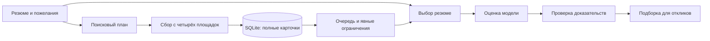

# Career Scout

**Поиск и отбор вакансий под ваши резюме на российском рынке.**


[Первый запуск](https://github.com/timsmykov/career-scout/blob/main/docs/quickstart.md) · [Документация](https://github.com/timsmykov/career-scout/blob/main/docs/README.md) ·
[Архитектура](https://github.com/timsmykov/career-scout/blob/main/docs/architecture.md) · [Кейс](https://github.com/timsmykov/career-scout/blob/main/docs/case-study.md) · [English](https://github.com/timsmykov/career-scout/blob/main/README.en.md)

Career Scout собирает полные вакансии из HH, Habr, SuperJob и «Работы России»,
сохраняет их в SQLite и сопоставляет с полными резюме и пожеланиями кандидата.
Результат — ссылки для самостоятельных откликов, подходящее резюме и основания
оценки. Настраивать сервис может человек или агент через JSON CLI.

**Сейчас инструмент предназначен для российского рынка:** HH, Habr, SuperJob и
«Работа России». Международный поиск пока вне охвата этой версии: для него нужны
другие источники и отдельный механизм поиска и отбора. Смена языка резюме или
географии в настройках сама по себе не добавляет такую поддержку.

**0.1.0 — личная alpha-версия для Linux/Python 3.12.** Основной путь — настраиваемый CLI в `main`; стабильный релиз 1.x не заявлен.
[Что проверено и что осталось](https://github.com/timsmykov/career-scout/blob/main/docs/product-audit-0.1.md).

## Как это работает



Сбор, страницы, дедупликация, бюджеты, сохранение и очередь выполняет код.
При нескольких резюме внешний Decisions-коннектор выбирает одно или два; при
одном резюме и выключенном автоотсеве классификация не нужна. Выбранная модель оценивает
каждую вакансию независимо, до 20 карточек одного резюме в батче, до 4 слотов.

## Что можно делать

| Задача | Поведение |
|---|---|
| Настроить поиск под себя | Произвольные резюме, цели, свободные пожелания и обязательные условия |
| Собрать вакансии | Полные описания, источник и ID, страницы, окно публикации, продолжение после сбоя |
| Добавить новые | Новый ручной проход перечитывает выдачу, скачивает описания только новых ID |
| Получить рекомендации | PASS отдельно от UNCERTAIN, категории по резюме, ссылки и explain |
| Сохранить прогресс | Версии контекста, квитанции request-id, кэш оценок, конечные бюджеты |
| Учесть отклики | Импорт истории скрывает уже откликнутые вакансии |
| Проверить качество | Метрики по своей контрольной разметке; без неё качество отмечено как неизмеренное |

Профессия и отрасль не зашиты в новый CLI. Отсутствие зарплаты или другого
необязательного поля само по себе не становится отказом.

## Начать

```sh
git clone https://github.com/timsmykov/career-scout.git
cd career-scout
uv sync --locked
uv run --no-sync career-scout version
uv run --no-sync career-scout schema
```

Используйте [пошаговую инструкцию](https://github.com/timsmykov/career-scout/blob/main/docs/quickstart.md): она проводит от одного
резюме до первой подборки с конечными HTTP- и модельными бюджетами.

- **Для сбора** нужны собственные доступы к выбранным источникам; env-файл — по
  [.env.example](https://github.com/timsmykov/career-scout/blob/main/.env.example). Права на хранение данных оформляются отдельно.
- **Для оценки** выберите Codex/ChatGPT, Claude Code через подписку или одно из
  десяти API-подключений, включая OpenRouter. [Модели и настройка](docs/model-providers.md).
- **Для нескольких резюме** нужен совместимый внешний Decisions-коннектор.
  Он пока не поставляется с пакетом. [Подключения](https://github.com/timsmykov/career-scout/blob/main/docs/context-evaluation.md).
- **Docker** содержит коллектор и CLI; Codex и авторизация в образ не входят.
  SQLite вынесена в постоянный volume. [Docker и данные](https://github.com/timsmykov/career-scout/blob/main/docs/docker.md).

## Подключить агента

```sh
uv run --no-sync career-scout skill install --agent codex
# Для Claude Code: замените codex на claude.
```

[Устанавливаемый Agent Skill](docs/agent-skill.md) ведёт агента через настройку
резюме, поисковый план, конечные бюджеты, продолжение и подборку. Пользователь
предоставляет свои резюме, предпочтения и доступы.

## Настроить под себя

В публичной поставке нет профиля автора: город, зарплата, отрасль, профессия и
стаж не выбраны за пользователя. [Руководство по адаптации](docs/personalization.md).

| Что заменить | Где |
|---|---|
| Полные резюме и названия направлений | context.resumes с произвольными resume_id |
| Цели, обязательное и желательное | goals, preferences и явные fact_rules |
| Запросы, география и площадки | plan.queries / source_options / sources |
| Модель, батчи, слоты и бюджеты | connection и параметры evaluation prepare |
| Каталог данных и свои доступы | --workspace и ссылка --env |

Начните с одного CV: внешний Decisions-коннектор для него не нужен при выключенном
автоотсеве. Если используете прежний collector CLI/TOML, передайте свои --query или
настройте families. Без этого placeholder останавливает запуск до HTTP. В публичном
TOML разрешены все грейды/категории стажа, нет отраслевого ограничения и скрытого
потолка лет; SuperJob storage_allowed=false требует вашего отдельного решения.

## Четыре источника

| Источник | Транспорт | Особенность |
|---|---|---|
| HH | Официальный API | Авторизация приложения, полные карточки, разбиение больших окон выдачи |
| Habr | Frontend JSON + HTML | Нет подтверждённого публичного API поиска; интеграция зависит от frontend |
| SuperJob | Официальный API | Ключ приложения и явное разрешение постоянного хранения |
| «Работа России» | Официальный REST | Своя пагинация, география и составной идентификатор |

[Контракты площадок](https://github.com/timsmykov/career-scout/blob/main/docs/sources/README.md). Успешный probe подтверждает доступ
в момент проверки; он не гарантирует полный охват рынка или будущую доступность.

## Проверка и ограничения

Для публичной поставки прошли **526 offline-тестов**, сборка wheel/sdist, сохранение данных
после пересоздания контейнера и полный сценарий установленного пакета с эмуляторами
HTTP/Codex. Отдельные живые поиск и detail проверены у всех четырёх площадок.
[Текущий аудит CLI и границы выводов](docs/cli-audit-20261114.md).

Смысловая точность нового персонального отбора ещё требует широкой разметки.
Проверка цитат не гарантирует правильного вывода модели. Автоотсев Decisions по
вероятности по умолчанию выключен. Приложение не отправляет отклики, не правит
резюме и не запускает расписание. Сохранённые старые описания автоматически не
обновляются; перед откликом проверьте оригинал вакансии.

## Навигация

- Пользователю: [резюме и условия](https://github.com/timsmykov/career-scout/blob/main/docs/guides/candidate.md), [сбор](https://github.com/timsmykov/career-scout/blob/main/docs/guides/collection.md),
  [анализ и подборка](https://github.com/timsmykov/career-scout/blob/main/docs/guides/evaluation.md), [решение проблем](https://github.com/timsmykov/career-scout/blob/main/docs/troubleshooting.md).
- Разработчику: [CONTRIBUTING](https://github.com/timsmykov/career-scout/blob/main/CONTRIBUTING.md), [модули](https://github.com/timsmykov/career-scout/blob/main/src/career_scout/README.md),
  [CLI-контракт](https://github.com/timsmykov/career-scout/blob/main/docs/agent-cli.md), [схемы](https://github.com/timsmykov/career-scout/blob/main/schemas/agent-context.schema.json),
  [вымышленные примеры](https://github.com/timsmykov/career-scout/blob/main/examples/README.md).
- О продукте: [кейс и решения](https://github.com/timsmykov/career-scout/blob/main/docs/case-study.md), [аудит 0.1](https://github.com/timsmykov/career-scout/blob/main/docs/product-audit-0.1.md),
  [история изменений](https://github.com/timsmykov/career-scout/blob/main/CHANGELOG.md), [границы продукта](https://github.com/timsmykov/career-scout/blob/main/docs/product.md).

Прежний `python -m career_scout` и четыре демонстрационных профиля сохранены отдельным
совместимым режимом. Их [TOML-фильтры](https://github.com/timsmykov/career-scout/blob/main/docs/filtering.md) не являются настройками
нового персонального CLI. [Указатель всей документации](https://github.com/timsmykov/career-scout/blob/main/docs/README.md).

## Участие и лицензия

Сообщения об ошибках и небольшие проверяемые PR приветствуются.
[Как внести вклад](https://github.com/timsmykov/career-scout/blob/main/CONTRIBUTING.md) · [Безопасное сообщение об ошибке](https://github.com/timsmykov/career-scout/blob/main/SECURITY.md).
Реальные резюме, вакансии, ключи, cookies и рабочие базы не включаются в Git.

Собственный код распространяется по [MIT](https://github.com/timsmykov/career-scout/blob/main/LICENSE). Сторонние права и использованные
референсы описаны в [NOTICE](https://github.com/timsmykov/career-scout/blob/main/NOTICE.md) и [reuse](https://github.com/timsmykov/career-scout/blob/main/docs/reuse.md).
