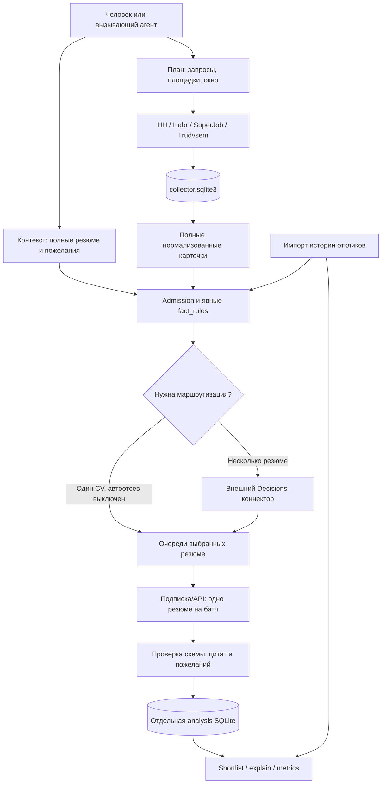

# Архитектура

Career Scout — личная установка с JSON CLI, локальными SQLite и внешним
настраиваемым исполнителем моделей. Управление сбором и очередью выполняет код. Новый поток
`context-1` работает с произвольными резюме; ранний четырёхпрофильный анализ
сохраняется отдельно. [Границы продукта](product.md) · [Приёмка](product-audit-0.1.md).

## Путь данных



## Компоненты и ответственность

| Слой | Модули | Ответственность |
|---|---|---|
| Интерфейс | agent_cli, agent_service, agent_results | JSON-команды, планы, конечное исполнение, выдача |
| Управление | agent_state | Версии контекста, request-id, сохранённые намерения/квитанции, блокировки |
| Источники | hh, adapters, transport, source_types | Auth, search/detail, native pagination, timeout/retry/cooldown |
| Коллектор | campaigns, storage, migrations | Initial/new/resume, ID, snapshots, checkpoint, миграции с backup |
| Общий формат | models, normalization, source_normalization | Vacancy v2, условия и происхождение без выдуманных значений |
| Персональная оценка | context_models, context_commands, context_engine | Admission, fact_rules, маршруты, бюджеты и итоговые статусы |
| Модельный транспорт | decisions, codex_worker, batch_worker | Внешние вызовы с конечными попытками; одно CV на батч |
| Доказательства | evidence, evaluation, context_policy | Проверка идентичности, исходников, диапазонов и допустимости вывода |

[Карта исходников](../src/career_scout/README.md). Имена в таблице — Python-модули,
не отдельные постоянно работающие микросервисы.

## Что решает код, что решает модель

Код отвечает за HTTP, страницы, окно публикации, дедупликацию, нормализацию,
обязательные сопоставимые fact_rules, admission, блокировки, бюджеты и проверку
ответов. Из свободного пожелания код не придумывает regex или квалификацию.

При нескольких резюме Decisions получает полный контекст и карточку. Код выбирает
одно/два resume_id по сохранённым вероятностям и routing_margin. При одном CV и
выключенном Decisions-отсеве этот вызов пропускается. Сам коннектор внешний и
не включён в пакет. Автоотсев по mismatch по умолчанию выключен.

Выбранная модель сопоставляет задачи, опыт, существенные требования и пожелания. Ответ
PASS/UNCERTAIN/REJECT сохраняется только после проверки схемы и доказательств.
Дословная цитата подтверждает происхождение фрагмента, но не истинность трактовки.
[Точный контракт](context-evaluation.md).

## Хранение и границы

```text
WORKSPACE/
  control.sqlite3                  # контексты, планы, операции и collection runs
  collector.sqlite3                # full карточки, версии и прогресс источников
  history.sqlite3                  # личная история откликов
  auth/                            # локальный token cache
  run-locks/                       # блокировки коллектора
  evaluations/CONTEXT_ID/
    CONTEXT_HASH.sqlite3            # входы, оценки, попытки и admission этой версии
```

Collector schema v5 поддерживает миграции v1–v4 с backup; исходные payload/hash
не переписываются при новом нормализаторе. Identity — source/source_id; у Trudvsem
ID составной. [Нормализация](normalization.md) · [Хранение](storage.md).

Начало внешней попытки и её бюджет сохраняются до обращения. Успешные элементы
батча пишутся независимо; ошибка соседа их не стирает. Модельные потоки не
используют SQLite-соединение координатора. До 4 слотов работают с батчами до 20
карточек, каждое задание содержит только одно резюме.

Изменение контекста создаёт новую версию оценок. Прежние выводы не выдаются за
оценку по новым пожеланиям. История откликов общая в пределах личного workspace;
разные личные установки данными не обмениваются.

## Продолжение и неопределённый исход

Сохранённый source ID не создаёт дубль full-карточки; следующий new скачивает
описания новых ID. В одной версии контекста ранее принятая карточка не попадает
в следующую порцию prepare повторно, включая незавершённые оценки. Для неё нужен resume.

Request-id идентифицирует команду, а не запрос свежего статуса. С тем же ID
возвращается исходная квитанция. Если доставка модельного вызова неизвестна,
новый request-id не разрешает скрытый повтор. Exactly-once во внешней сети
не обещается. [Восстановление](operations.md).

## Размещение и совместимость

Сбор можно запускать в Docker с постоянным volume. Анализ работает на хосте
с собственным Codex/ChatGPT login; в image нет Codex и Decisions helper.
Публичного HTTP API, MCP-сервера, общего multi-user backend и scheduler нет.

`python -m career_scout` — прежний CLI/TOML коллектора.
`python -m career_scout.analysis` и analysis-команды нового CLI поддерживают
прежние данные. `analysis_graph` использует LangGraph для старого first-PASS;
`routed_pipeline` ведёт очереди кодом. В routed-режиме обе назначенные оценки
завершаются; PASS одной принимает карточку. [Legacy-контракт](routing-batches.md).

Ранняя схема с future analysis/expiry больше не описывает текущий поток и
заменена схемой выше. Refresh старых описаний и retention остаются вне 0.1.

API и подписочные транспорты разделяют batch/evidence validation и очередь.
[Каталог подключений](model-providers.md), [устанавливаемый навык](agent-skill.md).
